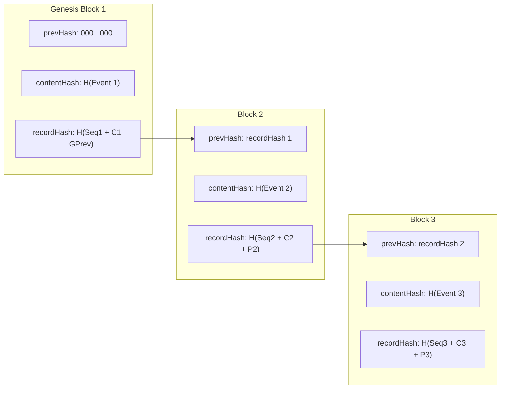

# Architecture Overview & Engineering Rationale

**Charles Schwab & Co., Inc. — Audit Log Service System Architecture**  
**Author**: Vishal Gaikwad (`gaikwadvishal2001@gmail.com`)  
**Version**: 2.0.0

---

## 1. System Mission & Core Guarantees

The **Audit Log Service** provides an immutable, append-only, tamper-evident ledger for recording mission-critical enterprise events across all Charles Schwab systems.

### Core Invariants
1. **Append-Only Immutability**: No API routes exist to mutate (`PUT`, `PATCH`) or delete (`DELETE`) audit records.
2. **Deterministic Cryptographic Chaining**: Every record's hash mathematically binds its own canonical payload, its sequential block number, and the cryptographic hash of the immediate predecessor.
3. **Provable Tamper Detection**: Any database-level alteration, row deletion, reordering, or truncation is detected with the exact sequence number and failure classification.
4. **Non-Breaking Redaction**: Sensitive PII fields can be cryptographically committed and masked without breaking the parent block's historical content hash.
5. **Compliant Lifecycle & Archival**: Older records can be archived according to SEC / FINRA retention windows without false-positive chain breaks.

---

## 2. Cryptographic Architecture

### 2.1 Canonical Serialization (RFC 8785)
A common vulnerability in hash chaining is serialization non-determinism across platforms, operating systems, and language runtimes (e.g., whitespace variations, unsorted dictionary keys).

We enforce deterministic canonical serialization:
```text
C(data) = JSON.stringify(data, sort_keys=True, separators=(",", ":"))
```

### 2.2 Hash Chain Formulation
1. **Genesis Block**: Sequence #1 binds to a known genesis root:
   $$\text{prev\_hash}_1 = \text{"0"} \times 64$$
2. **Content Hash**:
   $$\text{content\_hash}_i = \text{SHA-256}(C(\{\text{actorId}, \text{eventType}, \text{payload}, \text{resourceId}, \text{resourceType}, \text{timestamp}\}))$$
3. **Record Block Hash**:
   $$\text{record\_hash}_i = \text{SHA-256}(C(\{\text{contentHash}: \text{content\_hash}_i, \text{prevHash}: \text{record\_hash}_{i-1}, \text{sequenceNum}: i\}))$$



---

## 3. Data Model & Storage

### Relational Schema (`audit_records`)
- `id`: Surrogate autoincrement primary key.
- `sequence_num`: Unique strictly monotonic sequential integer ($1, 2, 3, \dots$).
- `event_type`: Indexed string (e.g., `USER_LOGIN`, `RECORD_UPDATED`, `ACCOUNT_VIEWED`).
- `actor_id`: Indexed identifier of initiating actor.
- `resource_type`, `resource_id`: Indexed resource coordinates.
- `payload_json`: Deterministic canonical representation of business payload.
- `timestamp`: UTC ISO-8601 authoritative timestamp.
- `content_hash`: 64-character SHA-256 hex digest.
- `prev_hash`: 64-character SHA-256 hex digest of predecessor.
- `record_hash`: 64-character SHA-256 block hash.
- `is_archived`, `archived_at`, `archival_reason`: Soft-deletion / retention flags.
- `redaction_metadata_json`: Cryptographic commitment receipts for redacted fields.

---

## 4. Scenario Breakdown

### Scenario A: Greenfield Core Service
- **Write API**: `POST /audit/events` validates payload, establishes next sequence number, hashes content and block, and commits atomically.
- **Query API**: `GET /audit/events` supports indexed multi-attribute filtering by actor, resource, eventType, timestamp ranges, and pagination (`limit`, `offset`).
- **Chain Verification**: `GET /audit/verify` traverses ledger in sequence, detecting:
  - `CONTENT_HASH_MISMATCH`
  - `CHAIN_LINK_BROKEN`
  - `SEQUENCE_DISCONTINUITY`
  - `GENESIS_MISMATCH`
  - `RECORD_HASH_MISMATCH`

### Scenario B: Lifecycle, Redaction & Verifiable Export
- **Retention Policy**: `POST /audit/retention/apply` marks expired records as archived. Chain verification validates unbroken linkage without false positives.
- **Structured Redaction**: `POST /audit/redact` replaces targeted sensitive fields (e.g. SSN, bank accounts) with cryptographic commitment tokens:
  $$\text{Commitment} = \text{SHA-256}(\text{salt} + ":" + \text{fieldName} + ":" + C(\text{value}))$$
  The original content hash and record hash are preserved, enabling mathematical privacy compliance without invalidating block history.
- **Bulk Export**: `GET /audit/export` packages records for an actor or resource with boundary metadata and a root `bundleIntegrityHash` for offline independent auditing.

### Scenario C: Ambiguous Requirement Normalization
- **Normalized Requirement**: Regulatory compliance audit reporting for client account access trails under SEC Rule 17a-4 and FINRA Rule 4511.
- **Delivered Capabilities**: `GET /audit/compliance/client-access` aggregates all actor access events, detects missing compliance justifications, flags anomalous high-frequency access, and verifies underlying chain authenticity.

---

## 5. Live Defense Preparation Guide

When walking through your code live with the Schwab review panel:
1. **Run Test Suite**: `pytest -v` runs all 8 unit and integration tests across Scenarios A, B, and C.
2. **Start Interactive Server**: `uvicorn app.main:app --reload --port 8000`. Show the interactive documentation at `http://localhost:8000/docs`.
3. **Demonstrate Tampering Live**:
   - Write 3 events via `/audit/events`.
   - Call `/audit/verify` -> returns `{"intact": true}`.
   - Open SQLite directly or run a script modifying `payload_json` of record 1.
   - Call `/audit/verify` -> returns `{"intact": false, "firstBrokenSequence": 1, "violationType": "CONTENT_HASH_MISMATCH"}`.
4. **Demonstrate Redaction Live**:
   - Show how calling `/audit/redact` masks the SSN in storage while `/audit/verify` confirms the chain remains intact.
